 

---

## About

I'm a Computer Science and Engineering student moving toward a career in aerospace engineering, being interested in both aircraft and space systems, and in using computing to make flight safer and more reliable.

**Goal:** to build a career in aerospace engineering, working on aircraft and space systems.

**Interests:** `Aerodynamics` `Flight Dynamics` `Aircraft Systems` `Space Systems` `UAVs` `Lunar Exploration` `Machine Learning for Aerospace` `Simulation`

**Working on:** my undergraduate thesis on federated and explainable AI, and a learned aerodynamic model with a safety fallback.

## Research

### Federated Generative AI and Explainable AI for Resilient IoT Botnet Detection

A CNN-BiGRU detector trained with Federated Averaging across nine IoT device clients on the full N-BaIoT dataset, reaching `99.94%` accuracy without sharing raw traffic. A TVAE-based, drift-aware aggregation keeps it stable under label drift, and SHAP and LIME explain each decision.

## Projects

<table>
<tr>
<td colspan="2" valign="top">

### [Confidence-Aware Fallback for a Learned Aerodynamic Surrogate](https://github.com/JTI22/confidence-aware-aero-surrogate-fallback)

A Gaussian Process surrogate for NACA 0012 aerodynamics, trained on XFOIL data and built from scratch in MATLAB. When the model is unsure, an uncertainty gate falls back to a lookup table. Tested in a closed-loop `6-DOF Simulink` model with gust and trim-runaway faults near stall.

</td>
</tr>
<tr>
<td colspan="2" valign="top">

### [One Degree — Terrain-Aware Lunar Landing Planner](https://github.com/JTI22/One_Degree_Lunar_Planner)

Sun and Earth visibility planner for lunar south-pole landing sites, built with NASA LOLA terrain and JPL Horizons. Compares sites and landing dates, and replays the model against three real landers: `Odysseus`, `Blue Ghost` and `Athena`.

</td>
</tr>
<tr>
<td width="50%" valign="top">

### [UAV Collision Advisory & Telemetry](https://github.com/JTI22/uav-collision-advisory-telemetry)

Software-in-the-loop UAV safety system on a simulated STM32F103. Estimates `time-to-collision`, detects blind spots and streams live telemetry to a Python ground station.

</td>
<td width="50%" valign="top">

### [Medical Delivery Robot](https://github.com/JTI22/Capstone_Code)

ESP32 4WD line follower with PID control and an ultrasonic obstacle stop. `RFID` tags mark the delivery stations, and a Wi-Fi web page controls each delivery.

</td>
</tr>
</table>

## Coursework

<table>
<tr>
<td width="50%" valign="top">

**Modelling & Mathematics**

`CSE 405` Numerical & Mathematical Analysis 
`MTH 201` Vector Geometry & Linear Algebra 
`MTH 103` Calculus I & II 
`MTH 203` Probability & Statistics 
`CSE 105` Discrete Mathematics

</td>
<td width="50%" valign="top">

**Autonomy & Intelligent Systems**

`CSE 437` Robotics + Lab 
`CSE 413` Machine Learning & Deep Learning + Lab 
`CSE 401` Operating Systems + Lab 
`CSE 311` Data Communication & Networks + Lab 
`CSE 317` Computer & Cyber Security

</td>
</tr>
<tr>
<td width="50%" valign="top">

**Embedded & Electronics**

`CSE 315` Microprocessors & Microcontrollers + Lab 
`CSE 303` Computer Architecture & Organization 
`CSE 209` Digital Logic Design + Lab 
`EEE 201` Electronic Devices & Circuits + Lab 
`EEE 101` Electrical Circuits + Lab

</td>
<td width="50%" valign="top">

**Physics & Computing Core**

`PHY 301` Modern & Quantum Physics 
`PHY 101` Physics for Computer Science + Lab 
`CSE 207` Data Structures & Algorithms I–II 
`CSE 301` Object-Oriented Programming I–II 
`CSE 313` Software Engineering + Lab

</td>
</tr>
</table>

## Toolkit

<table>
<tr>
<td width="50%" valign="top" align="center">

**Machine Learning**

`NumPy` `Pandas` `XGBoost` `SHAP` `LIME`

</td>
<td width="50%" valign="top" align="center">

**Aero, Space & Simulation**

`Simulink` `XFOIL` `Astropy` `JPL Horizons`

</td>
</tr>
<tr>
<td width="50%" valign="top" align="center">

**Embedded & Systems**

`STM32CubeIDE` `ESP32` `PICSimLab` `UART`

</td>
<td width="50%" valign="top" align="center">

**Build & Write**

`Streamlit` `SQL` `Packet Tracer`

</td>
</tr>
</table>

## GitHub Activity

